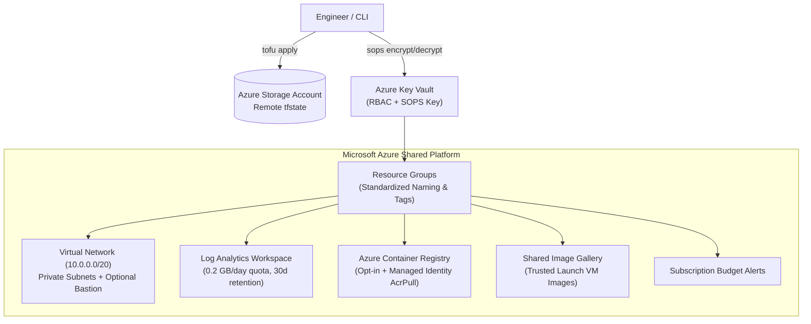

# Azure Shared Infrastructure as Code (`azure-terraform-infra`)

Modular **Microsoft Azure** shared cloud foundation provisioned with **OpenTofu / Terraform (HCL)**. Implements secure secret management using **Azure Key Vault + SOPS**, **RBAC** least-privilege access, isolated virtual networking, remote state management, observability, and FinOps cost guardrails.

## Architecture



## Key Components & Cloud Practices

- **Secrets Management (Key Vault + SOPS):** Azure Key Vault running in strict **Azure RBAC** mode (`rbac_authorization_enabled = true`) with a dedicated encryption key for **SOPS**, allowing encrypted `secrets.yaml` to be safely version-controlled in Git.
- **Networking & Access:** Shared Virtual Network (`10.0.0.0/20`) with private subnets (`default_outbound_access_enabled = false`) and opt-in **Azure Bastion** for secure administrative access without exposing public VM IPs.
- **Remote State Backend:** Dedicated Azure Storage Account with blob lifecycle management policy and RBAC role assignments (`Storage Blob Data Contributor`).
- **Observability & FinOps Guardrails:** Centralized **Log Analytics Workspace** capped at a `0.2 GB/day` ingestion quota (30-day retention), subscription-level **Budget Alerts**, and feature flags (`acr_enabled`, `bastion_enabled`) to prevent idle cloud spend.
- **Container & Image Registry:** Opt-in **Azure Container Registry (ACR)** authenticated via User-Assigned Managed Identity (`AcrPull`) and a **Shared Image Gallery** supporting Trusted Launch VM images.

## Prerequisites

- [OpenTofu](https://opentofu.org/) (`~> 1.12`) or Terraform
- [Azure CLI](https://learn.microsoft.com/en-us/cli/azure/) (`az login`)
- [SOPS](https://github.com/getsops/sops) for encrypting/decrypting `secrets.yaml`

## Quick Start

1. Export required environment variables:
   ```bash
   export TF_VAR_student_id="your-unique-id"
   export TF_VAR_contact_emails='["alerts@example.com"]'
   ```
2. Initialize and review the execution plan:
   ```bash
   az login
   tofu init
   tofu plan
   ```
3. Bootstrap Key Vault & SOPS encryption key first, then apply the full stack:
   ```bash
   tofu apply -target=azurerm_key_vault.this
   tofu apply -target=azurerm_key_vault_key.sops_encryption_key
   sops -e secrets.yaml > secrets.enc.yaml && mv secrets.enc.yaml secrets.yaml
   tofu apply
   ```

## Managing Encrypted Secrets with SOPS

```bash
# Edit encrypted secrets in-place (auto-decrypts and re-encrypts on save)
sops secrets.yaml

# Inspect decrypted content locally
sops -d secrets.yaml
```

> **Security note:** Never commit unencrypted secrets. Access to Key Vault keys and secrets is governed exclusively through Azure RBAC roles defined in `rbac.tf` (e.g., `Key Vault Crypto User`, `Key Vault Secrets Officer`).

## Project Structure

```text
azure-terraform-infra/
├── .sops.yaml              # SOPS Azure Key Vault encryption config
├── secrets.yaml            # SOPS-encrypted secrets (safe to commit)
├── naming.tf               # Standardized Azure naming convention & tagging
├── main.tf                 # Resource Groups
├── kv.tf, sops.tf, rbac.tf # Key Vault, SOPS integration & RBAC assignments
├── storage_account.tf      # Remote state Storage Account & lifecycle policy
├── backend.tf              # Remote OpenTofu/Terraform backend config
├── budget.tf               # Subscription cost budget alerts
├── variables.tf, locals.tf # Configurable inputs & feature flags
└── versions.tf             # Providers (azurerm ~> 5.8, sops ~> 1.3)
```

## License

This project is licensed under the [MIT License](LICENSE).
